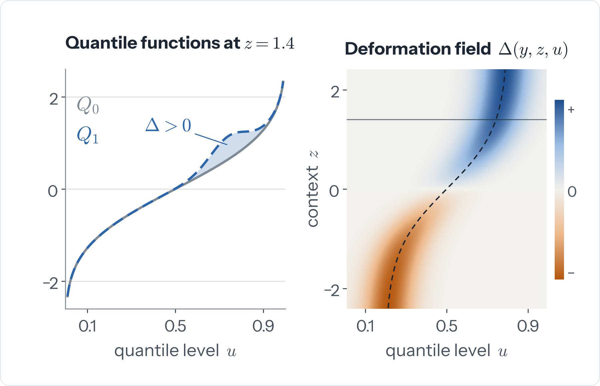
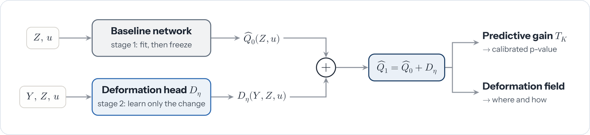
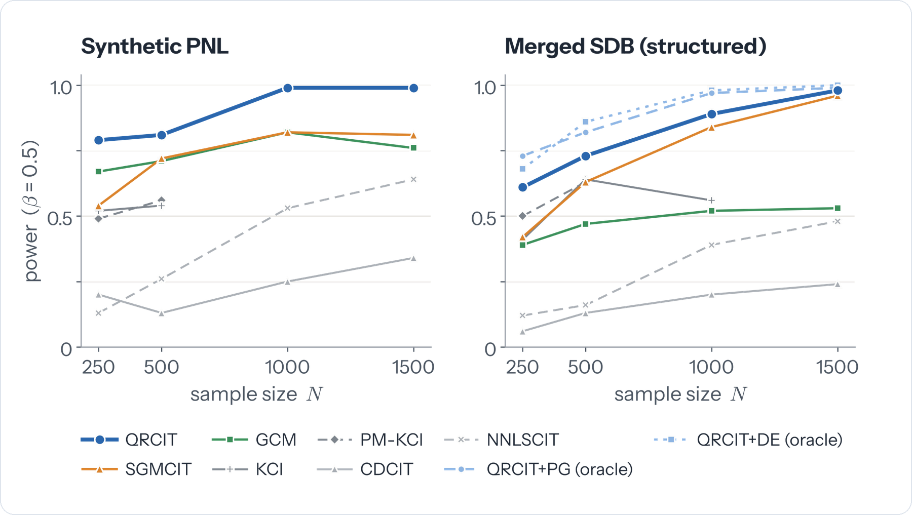
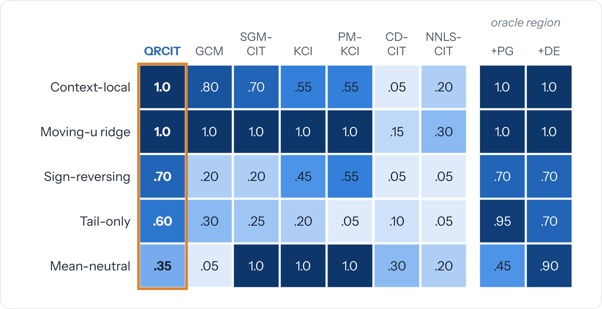
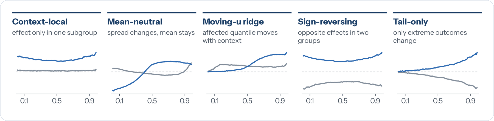
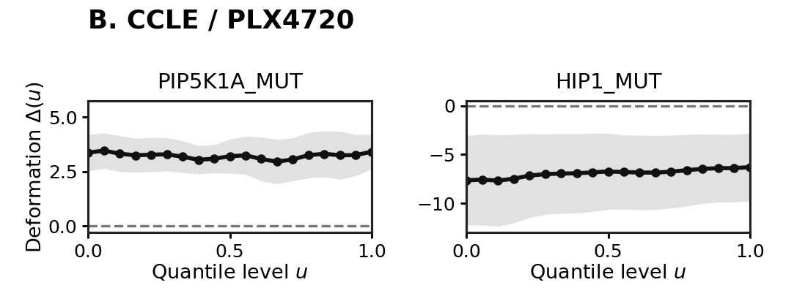

<div align="center">

# QRCIT

### Structural Conditional Independence Test via Neural Quantile Resolution

**Khoa Nguyen, Bao Duong and Thin Nguyen**<br>
Deakin Applied Artificial Intelligence Initiative

[](#citation)
[](pyproject.toml)
[](https://pytorch.org/)
[](LICENSE)
<!-- Add when public: [](PAPER_URL) -->

**A p-value tells you *whether* Y matters for X once Z is known.<br>
QRCIT also shows *where* and *how*.**

</div>

<p align="center">
  
</p>
<p align="center"><sub>QRCIT compares the conditional quantiles of X with and without Y. Their difference, the deformation Δ(y, z, u), is zero under conditional independence; otherwise it shows the contexts <i>z</i> and quantile levels <i>u</i> where Y changes X.</sub></p>

## Why QRCIT

Standard conditional independence tests compress the data into one statistic. That hides
dependence that lives in a subgroup, in the tails, or in the shape of the distribution.

- **Calibrated decision.** A global p-value from a conditional randomization test, provably valid when P(Y | Z) is known and the gain is evaluated on held-out data.
- **Built-in explanation.** A signed quantile deformation over context and quantile level, learned by the same model that drives the test and returned with the p-value.
- **Structured dependence.** Sensitive to context-local, tail-only and sign-reversing effects that averaged statistics dilute or cancel.
- **Resolution at no extra size.** The quantile level is a network input, so a finer quantile grid adds no parameters.

## How it works

<p align="center">
  
</p>

1. **Baseline.** A network learns the conditional quantiles of X given Z, then is frozen.
2. **Deformation.** A residual head learns only what Y adds, so the refined quantiles are the baseline plus the deformation.
3. **Test.** The predictive gain is the drop in pinball loss from adding Y, on held-out folds and over K quantile levels. Fake copies of Y drawn from an estimate of P(Y | Z) calibrate it into a p-value.

## Results at a glance

<p align="center">
  
</p>

| Benchmark | QRCIT | Best baseline |
| --- | :---: | :---: |
| Synthetic post-nonlinear (PNL), N = 1000 | **0.99** | 0.82 (GCM, SGMCIT) |
| Structural Dependency Benchmark (SDB), five patterns combined, N = 500 | **0.73** | 0.64 (KCI) |
| SDB tail-only, N = 500 | **0.60** | 0.30 (GCM) |
| SDB sign-reversing, N = 500 | **0.70** | 0.55 (PM-KCI) |

Power at α ≈ 0.05, averaged over 100 trials (20 per pattern for the single-pattern rows).
On real data, QRCIT reaches F1 = 0.80 on Sachs (second of five methods), gives the lowest downstream
tumor-size error on METABRIC, and flags both BRAF indicators on CCLE / PLX4720.

<details>
<summary><b>Power by structural pattern</b></summary>
<br>
<p align="center">
  
</p>

QRCIT is best or tied-best on four of five patterns. Mean-neutral shape changes are the hard case
for the global test (0.35), where kernel and score-based tests do better; testing inside the
affected region raises it to 0.90.
</details>

## Installation

Use **Python 3.12** on Linux or macOS.

```bash
git clone https://github.com/khoangdadk/qrcit.git
cd qrcit

python3.12 -m venv .venv
source .venv/bin/activate
python -m pip install -e ".[metabric]"
```

This installs QRCIT and the dependencies for the experiments, including XGBoost
for METABRIC. The pinned reference environment is in
[requirements.txt](requirements.txt). Run the commands below from the repository root.

## Quick start

Test whether `Y` adds information about `X` once `Z` is known:

```python
from qrcit import QRCITConfig, test_independence
from qrcit.datasets import pnl

data = pnl(n=1000, d_z=5, beta=0.5, seed=123)
result = test_independence(
    data.X, data.Y, data.Z,
    config=QRCITConfig(seed=0),
)
print(f"p-value: {result.p_value:.4f}")
```

For your own data, replace `data.X`, `data.Y` and `data.Z` with arrays of
shape `(n_samples, n_features)`. This example uses scalar continuous `X`
and `Y`, with multivariate `Z`. For multivariate `X`, see
[`SlicedQRCIT`](qrcit/sliced.py).

### See where and how

The result also holds the held-out deformation field. `result.deformation[i, k]`
is how much `Y` shifts quantile level `result.u_grid[k]` of `X` for sample `i`,
in the units of `X`. It stays near zero under conditional independence.

```python
import matplotlib.pyplot as plt
import numpy as np

D, u = result.deformation, result.u_grid          # shapes (n, K) and (K,)
high = data.Y[:, 0] > np.median(data.Y[:, 0])

plt.plot(u, D[high].mean(axis=0), label="high Y")
plt.plot(u, D[~high].mean(axis=0), label="low Y")
plt.axhline(0, color="grey", linestyle="--")
plt.xlabel("quantile level u")
plt.ylabel("deformation (units of X)")
plt.legend()
plt.show()
```

Group the rows by any variable, or plot them against a coordinate of `Z`, to see
which contexts and which parts of the distribution `Y` affects.

## Datasets

<p align="center">
  
</p>
<p align="center"><sub>The Structural Dependency Benchmark (SDB). Each panel shows the quantile shift across quantile levels <i>u</i> for two slices of the data (grey and blue: two contexts, or low and high Y).</sub></p>

| Dataset | Data | Task |
| --- | --- | --- |
| **PNL** | Synthetic post-nonlinear models | Detect nonlinear conditional dependence. |
| **SDB** | Five structured dependence patterns (above) | Detect dependence localized in context or quantile level, including tail-only and mean-neutral changes. |
| [**Sachs**](data/sachs) | Protein measurements from 1,755 cells | Evaluate conditional independence queries in a biological signaling network. |
| [**METABRIC**](data/metabric) | 1,491 breast cancer patients and 169 gene-expression features | Select genes associated with tumor size given other genes and clinical covariates. |
| [**CCLE / PLX4720**](data/ccle) | 474 cancer cell lines and 75 mutation indicators | Test whether mutation status adds information about drug response given other mutations. |

Processed real-data inputs are included in [data/](data/).
Synthetic data are generated by the experiment runners.

## Run experiments

Each command runs the complete workflow for one experiment. Model settings are in [configs/](configs/).

<details>
<summary><b>Synthetic benchmarks (PNL and SDB)</b></summary>

```bash
python -m experiments.run --benchmark pnl --out runs/pnl
python -m experiments.run --benchmark sdb --out runs/sdb
```

The same runner supports `--benchmark role-swap` and
`--benchmark multivariate`. Use `--help` to adjust sample size,
conditioning dimension or quantile resolution.
</details>

<details>
<summary><b>Sachs</b></summary>

Run the tests and summarize their predictions:

```bash
python -m experiments.sachs --device cpu --out runs/sachs
python -m experiments.collect_sachs runs/sachs --out artifacts/sachs
```
</details>

<details>
<summary><b>METABRIC breast cancer</b></summary>

Screen genes, collect the selected sets, then evaluate tumor-size prediction:

```bash
python -m experiments.metabric --out runs/metabric/genes
python -m experiments.collect_metabric runs/metabric/genes --out runs/metabric/screen
python -m experiments.metabric_downstream \
  --screen runs/metabric/screen/screen.json --out runs/metabric/downstream
```
</details>

<details>
<summary><b>CCLE / PLX4720</b></summary>

Test mutation–response associations and plot the estimated quantile changes:

```bash
python -m experiments.ccle --out runs/ccle
python -m experiments.report_ccle --runs runs/ccle --out artifacts/ccle
python -m experiments.plot_ccle --runs runs/ccle --out artifacts/ccle
```
</details>

### Saved results and figures

Saved QRCIT outputs and baseline summaries are in [results/](results/).
To regenerate the synthetic figures and inspect the real-data results without
training new models:

```bash
python -m experiments.reproduce --out artifacts/synthetic
python -m experiments.verify_sachs
python -m experiments.verify_metabric
python -m experiments.report_ccle --out artifacts/ccle
python -m experiments.plot_ccle --out artifacts/ccle
```

<p align="center">
  
</p>
<p align="center"><sub>Estimated changes in PLX4720 response (Amax; more negative means stronger growth inhibition) across quantile levels for PIP5K1A and HIP1 mutation status.</sub></p>

## Layout

```text
qrcit/         core package: models, losses, calibration, sliced multivariate test
experiments/   runners and plotting scripts for every table and figure
configs/       model settings for each experiment
data/          processed Sachs, METABRIC and CCLE / PLX4720 inputs
results/       saved outputs used in the paper
tests/         unit tests
```

## Citation

```bibtex
@inproceedings{nguyen2026qrcit,
  title     = {Structural Conditional Independence Test via Neural Quantile Resolution},
  author    = {Nguyen, Khoa and Duong, Bao and Nguyen, Thin},
  booktitle = {IEEE International Conference on Data Mining (ICDM)},
  year      = {2026}
}
```

## License

QRCIT is released under the [MIT License](LICENSE).
